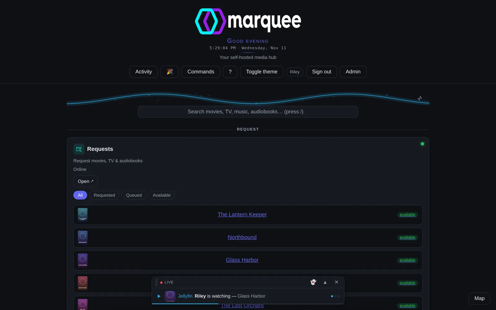
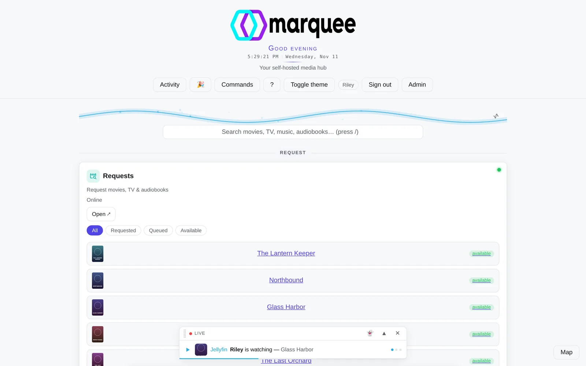
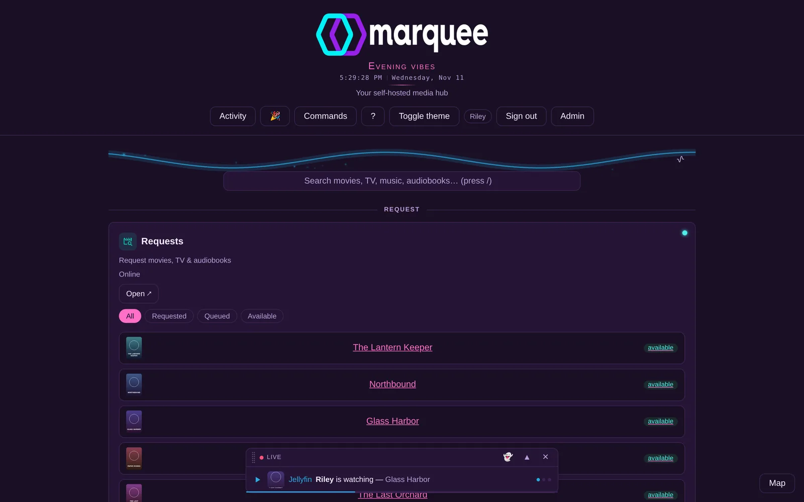
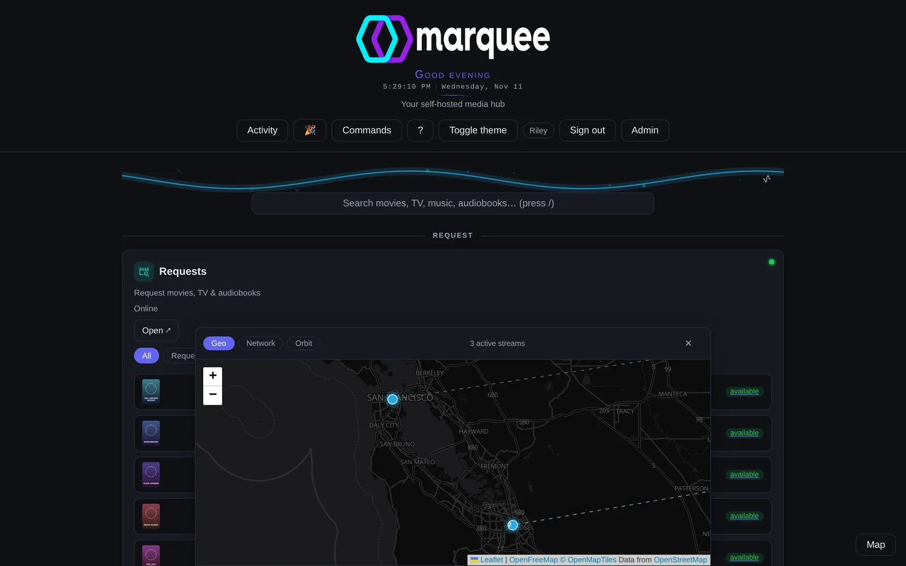
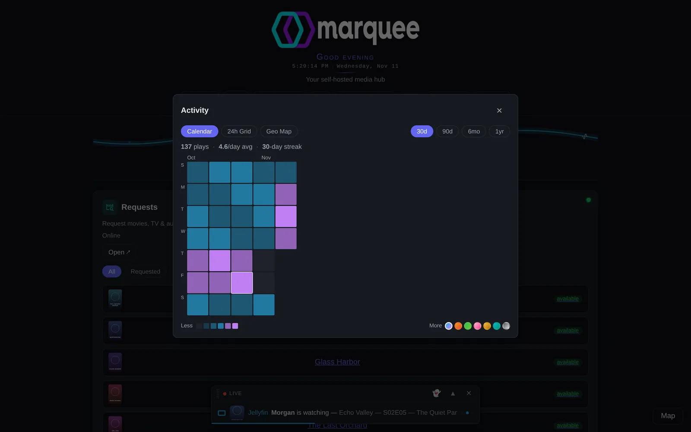
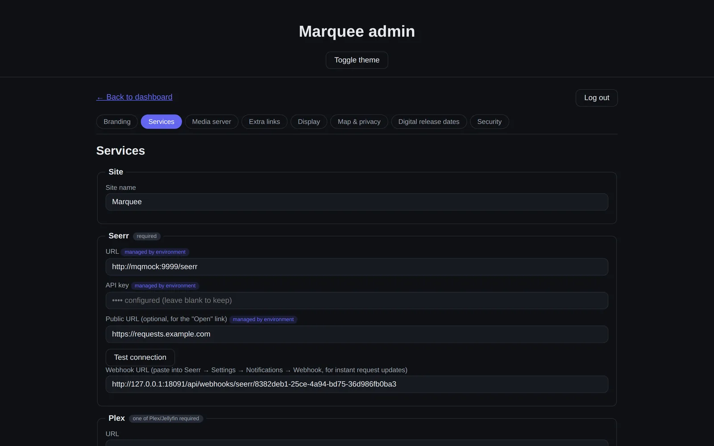
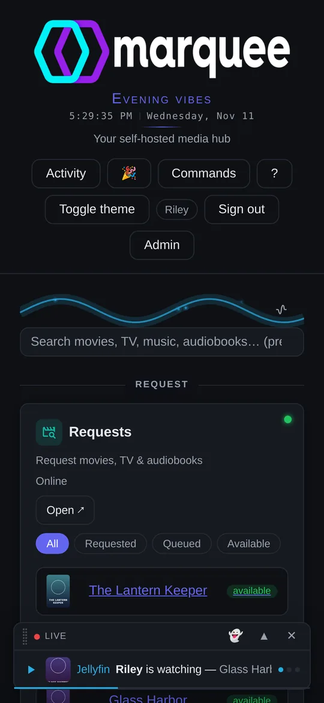

<p align="center">
  <picture>
    <source media="(prefers-color-scheme: dark)" srcset="frontend/public/brand/marquee-logo-dark.png">
    
  </picture>
</p>

<p align="center">
  <strong>A self-hosted dashboard for your media server — what's playing, what's coming, and what's been requested, on one page you can share with friends and family.</strong>
</p>

<p align="center">
  <a href="https://github.com/jbuxxy/marquee/releases"></a>
  <a href="https://github.com/jbuxxy/marquee/pkgs/container/marquee"></a>
  <a href="LICENSE"></a>
</p>

<p align="center">
  
</p>

Marquee sits in front of **Plex or Jellyfin** and **Seerr** (Overseerr / Jellyseerr)
and turns them into one page: a live now-playing ticker, request status, recently
added, search across everything, viewing stats and a live map of who's watching
from where. Friends sign in with the Plex or Jellyfin account they already use;
everyone else sees an anonymized preview.

It's a single Docker container with a built-in settings page. No database, no
build step, nothing to edit by hand.

---

## Contents

- [Screenshots](#screenshots)
- [Features](#features)
- [Quick start](#quick-start)
- [Connecting your services](#connecting-your-services)
- [Putting it on the internet](#putting-it-on-the-internet)
- [Live updates (webhooks)](#live-updates-webhooks)
- [Letting friends sign in](#letting-friends-sign-in)
- [Updating, backups and troubleshooting](#updating-backups-and-troubleshooting)
- [Building from source](#building-from-source)

## Screenshots

| | |
|---|---|
|  |  |
| Light theme | One of 15 themes |
|  |  |
| Live map of active streams | Activity calendar, 24-hour grid and geo heat map |
|  |  |
| Everything is configured in the browser | Works on phones |

<sub>Screenshots use a demo server with made-up titles and users.</sub>

## Features

- **Live now playing** for Plex, Jellyfin and AudioBookShelf. Updates arrive the
  moment playback changes, with an animated activity waveform, progress bars,
  "open in app" links and a fullscreen *Now Casting* mode.
- **Seerr requests** with live status (requested → processing → available).
  Available items link straight to the title on your server. A *Coming Soon*
  strip shows digital release dates for pending movies.
- **Sign in with Plex or Jellyfin.** Visitors use the account they already have
  on your server; anyone else is turned away. Signed-in visitors get search,
  stats, the live map, personal recommendations, and can request titles **as
  themselves in Seerr**, so your Seerr permissions, quotas and auto-approve
  rules apply.
- **Privacy by design.** Guests see activity without titles or names.
  Signed-in visitors never see other viewers' IP addresses, file paths or
  email addresses. Only you, the owner, see everything.
- **Recommendations** from each visitor's own watch history (via Seerr/TMDB),
  plus audiobooks from AudioBookShelf history (via ReadMeABook).
- **Stats and maps**: viewing stats and an activity heat map from Tautulli
  (Plex) or Jellystat (Jellyfin), and a live map of where streams are coming
  from.
- **Search** across Plex, Jellyfin, AudioBookShelf and Seerr at once.
- **Make it yours**: 15 themes, seasonal effects, your own logo and name,
  custom link cards (Mealie, Homepage, anything), PDF guides for your users,
  and per-library exclusions (hide home videos everywhere).
- **Only what you use**: every card and feature appears only when its service
  is configured. One media server and Seerr is enough to start.
- **Secure by default**: no default password, hashed credentials, CSRF
  protection, rate-limited logins, a strict Content-Security-Policy, and
  service API keys never reach the browser. See [docs/SECURITY.md](docs/SECURITY.md).

## Quick start

You need Docker with Compose, a Seerr instance, and Plex or Jellyfin (or both).

**1. Create a folder and grab the two files you need**

```bash
mkdir marquee && cd marquee
curl -O https://raw.githubusercontent.com/jbuxxy/marquee/main/docker-compose.yml
curl -o .env https://raw.githubusercontent.com/jbuxxy/marquee/main/.env.example
mkdir config && sudo chown 1000:1000 config   # the container runs as uid 1000
```

**2. (Optional) Fill in `.env`**

You can put your server addresses and API keys in `.env` now, or leave it as is
and enter everything in the browser in step 4. Anything set in `.env` shows up
read-only in the settings page. See [Connecting your services](#connecting-your-services)
for where to find each key.

**3. Start it**

```bash
docker compose up -d
docker compose logs marquee
```

On first start Marquee generates an admin password and prints it **once**:

```
============================================================
marquee first-run admin password (shown once):

  9PsYQE_RErwF...

Save it now — it will not be shown again.
============================================================
```

Save it. (Prefer your own? Set `ADMIN_PASSWORD=` in `.env` before the first start.)

**4. Finish setup in the browser**

Open `http://<your-server>:8080`. Until Seerr and a media server are connected
you'll land on the setup wizard; sign in with the admin password and fill in the
connection details. Each service has a **Test connection** button. Once Seerr and
Plex or Jellyfin are working, the dashboard appears.

Everything else (optional services, themes, the map, branding, custom links) is
in the settings page at `/admin`.

## Connecting your services

Use the address Marquee can reach from inside Docker: a LAN address like
`http://192.168.1.20:32400`, or the container name if they share a Docker
network (`http://jellyfin:8096`). Each service also has an optional *public
URL*, used only for the "Open" links visitors click.

| Service | Needed for | Where to find the key |
|---|---|---|
| **Seerr** (Overseerr / Jellyseerr) | Required | Seerr → Settings → General → **API Key** |
| **Plex** | One of Plex / Jellyfin | Your Plex token: see Plex's guide *"Finding an authentication token / X-Plex-Token"* |
| **Jellyfin** | One of Plex / Jellyfin | Jellyfin → Dashboard → **API Keys** → `+` |
| AudioBookShelf | Audiobook now playing, search, recently added | ABS → Settings → Users → your user → **API Token** |
| Tautulli | Stats and heat map for Plex | Tautulli → Settings → Web Interface → **API key** |
| Jellystat | Stats and heat map for Jellyfin | Jellystat → Settings → **API Keys** |
| TMDB | Richer detail popups | themoviedb.org → Settings → API → **API Read Access Token** |
| Trakt | More accurate *Coming Soon* dates | trakt.tv/oauth/applications → New application → **Client ID** |
| ReadMeABook | Audiobook recommendations (with AudioBookShelf) | ReadMeABook settings → API token |

Every setting, environment variable and toggle is listed in
[docs/CONFIGURATION.md](docs/CONFIGURATION.md).

## Putting it on the internet

Run Marquee behind a reverse proxy that provides HTTPS (Nginx Proxy Manager,
Caddy, Traefik…) and set this in `.env`:

```env
TRUST_PROXY=true
```

That tells Marquee to trust the proxy's `X-Forwarded-Proto` and `X-Real-IP`
headers, so cookies are marked secure and login rate limits apply to the
visitor's real address rather than the proxy's. Make sure your proxy sets
`X-Real-IP` (Nginx Proxy Manager and Caddy do by default), and **only** enable
`TRUST_PROXY` when Marquee is not reachable directly.

<details>
<summary>Caddy example</summary>

```caddy
media.example.com {
    reverse_proxy marquee:8080 {
        header_up X-Real-IP {remote_host}
    }
}
```
</details>

<details>
<summary>Nginx example</summary>

```nginx
location / {
    proxy_pass http://marquee:8080;
    proxy_set_header Host $host;
    proxy_set_header X-Real-IP $remote_addr;
    proxy_set_header X-Forwarded-Proto $scheme;
    proxy_buffering off;              # live updates use server-sent events
    proxy_read_timeout 1h;
}
```
</details>

## Live updates (webhooks)

Jellyfin needs nothing extra. For Plex and Seerr, open `/admin` → **Services**:
each shows a webhook URL. Copy it into:

- **Plex**: Settings → Webhooks → *Add Webhook* (requires Plex Pass). Without it,
  Marquee still refreshes every 30 seconds.
- **Seerr**: Settings → Notifications → Webhook → *Webhook URL*, with
  notifications enabled for the request events you care about.

The URLs contain a random secret; treat them like passwords.

## Letting friends sign in

The **Sign in** button appears automatically once Plex or Jellyfin is connected.

- **Plex**: visitors sign in through plex.tv. Only accounts that own or have
  been shared your server are accepted.
- **Jellyfin**: visitors use their Jellyfin username and password.

For visitors to **request** titles, their account must exist in Seerr: Seerr →
Users → **Import Plex Users** / **Import Jellyfin Users**. Requests are then made
as that Seerr user, with their own permissions and auto-approve settings.

Sign-ins last 30 days. To keep them across container restarts, uncomment the
`redis` service in `docker-compose.yml` and set `REDIS_URL=redis://redis:6379`.

## Updating, backups and troubleshooting

**Update**

```bash
docker compose pull && docker compose up -d
```

**Back up** the `config` folder. It holds every setting, your admin password
hash, uploaded branding and guides. Nothing else in the container is stateful.

**Troubleshooting**

| Problem | Try |
|---|---|
| Lost the admin password | Set `ADMIN_PASSWORD=<new password>` in `.env` and restart. While it's set, it's the admin password |
| `EACCES` / permission errors in the logs | `sudo chown -R 1000:1000 config` |
| A status dot is red | `/admin` → Services → **Test connection**; check the URL is reachable *from the container* |
| Now playing doesn't update instantly | Add the Plex/Seerr webhooks; behind a proxy, turn off response buffering |
| Visitors can't request | Import their accounts into Seerr (see above) |
| Map shows nothing | Enable it in `/admin` → Map & privacy. Streams from your own network aren't plotted |

## Building from source

```bash
git clone https://github.com/jbuxxy/marquee.git
cd marquee
docker build -t marquee .
docker run -p 8080:8080 -v "$(pwd)/config:/config" marquee
```

The frontend is plain HTML, CSS and JavaScript served as-is; there's no bundler.
Run the tests with `npm test` (Node 22+). To try changes without Docker:

```bash
npm ci
MARQUEE_CONFIG_DIR=./config npm start
```

## Known limitations

- Jellystat support was written against its public API and hasn't been checked
  against every version. If a chart looks empty, please open an issue.
- Visitors whose accounts aren't imported into Seerr can browse but not request.

## Contributing

Issues and pull requests are welcome. Please run `npm test` before opening a PR;
it includes a check that keeps the Content-Security-Policy intact (no inline
scripts or `onclick=` handlers).

## License

[MIT](LICENSE)
